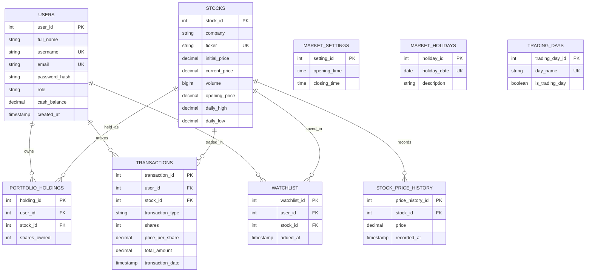

# Stock Market Website — Database Schema

## Project Overview

This schema represents the database for a stock market simulation website
built with HTML, CSS, JavaScript, Node.js, Express, and PostgreSQL
hosted on Neon.

The website allows users to view stock information, manage a watchlist,
track portfolio holdings, and simulate buying and selling stocks.

## Database Tables

- **users** — Stores user accounts, roles, and cash balances.
- **stocks** — Stores company names, ticker symbols, and stock prices.
- **portfolio_holdings** — Tracks the shares owned by each user.
- **transactions** — Records simulated stock purchases and sales.
- **watchlist** — Stores stocks saved by users.
- **stock_price_history** — Records stock prices over time.
- **market_settings** — Stores market opening and closing times.
- **market_holidays** — Stores market holiday dates and descriptions.
- **trading_days** — Identifies which days are trading days.

## Key Relationships

- A user can have multiple portfolio holdings.
- A stock can appear in multiple users' portfolio holdings.
- A user can make multiple transactions.
- A stock can be involved in multiple transactions.
- Users can save stocks to their watchlists.
- A stock can appear in multiple watchlists.
- A stock can have multiple historical price records.

## Diagram

The entity-relationship diagram below illustrates the database
tables and their relationships.

